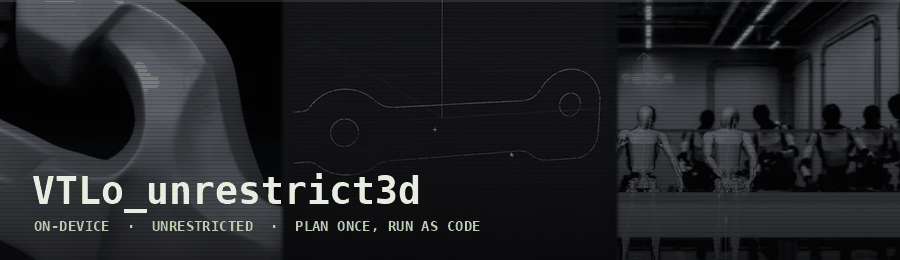

<p align="center"></p>

# VTLo_unrestrict3d

Minimal, crash-free Android chat app that runs a **LiteRT-LM** model fully offline (no INTERNET permission).
GPU (with MTP speculative decoding when the model ships a drafter) and automatic CPU fallback.
Animated header banner, plain dark readable chat.

## Build
`flake.nix` pins the whole toolchain (JDK 21, Gradle 9, Android SDK 37, AGP 9.2.1):
```
nix develop --command bash -c 'export GRADLE_USER_HOME=$PWD/.gradle-home && gradle :app:assembleDebug'
# -> app/build/outputs/apk/debug/app-debug.apk
```
GitHub Actions builds it too (`.github/workflows/build-apk.yml`).

## Model
Install the app, open it, tap **IMPORT MODEL** and pick your `.litertlm` file (it is copied into the app's private
files dir). Or copy it yourself to `/sdcard/Android/data/com.vtlo.unrestrict3d/files/model.litertlm`
and reopen. Loading happens once, on GPU first, CPU if the driver refuses.

## Notes
- LiteRT-LM 0.20.0, `maxNumTokens = 4096`, sampler topK 64 / topP 0.95 / temperature 1.0 (edit in `MainActivity.kt`).
- minSdk 31 (Android 12+), arm64 + x86_64.
